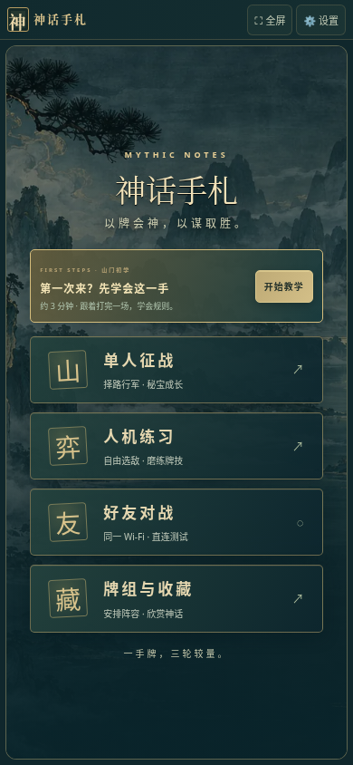
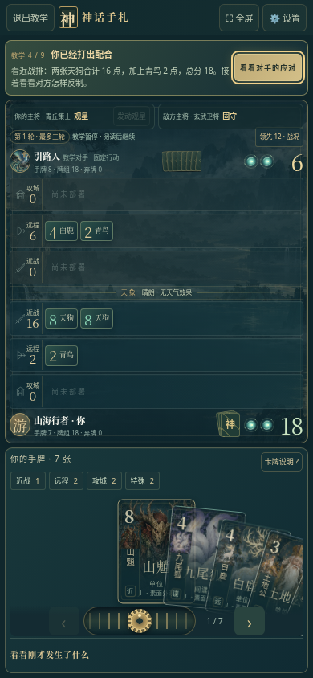

# 神话手札 v19 · 水墨山海与征途秘宝

[下载 v19 完整包：游戏、预览、说明与源码](https://github.com/ZZ677BIT/AI/raw/refs/heads/v19-ink-relics/v19.zip)

全部解压，用浏览器打开 `01_双击试玩.html`。新玩家先进入首页「开始教学」。

本版增加水墨山海背景与十二种角色插画，保留深青、古金的界面和手机竖屏手牌操作。

- 单人征战启程前选赤羽印、玄玉璧或归藏卷；过关补给可以选择升阶，最高三阶。
- 征途中选择不同的下一站对手；淬炼秘宝、调度手牌与重整阵容有所取舍。
- 三套可编辑的推荐牌组：赤羽同袍、青丘奇谋、玄冥守阵，附打法与弱点说明。
- 对局增加有限时长的配合与秘宝提示；战局手札展示公开比分、剩余手牌数量及最近行动。

推荐体验：牌组与收藏 → 牌组 → 载入赤羽同袍 → 保存，再进入单人征战选择赤羽印。

139 项规则与浏览器检查通过，其中包含 270 场带种子的自动对局。源码包重新构建的游戏与发行文件逐字节一致。游戏脚本、样式、素材均内嵌，单人玩法无需额外服务器。

手机适配使用模拟视口及触摸输入检查；尚未进行实体安卓自带浏览器的温度与帧率实测，长期数值平衡仍需试玩反馈。好友直连沿用 v17 测试版：双浏览器流程使用有序消息测试通道，真实两机 Wi-Fi 和摄像头扫码尚未完成验证。

收藏和进度存于当前浏览器本地存储。更换浏览器、设备、网址或本地文件路径不保证共享，没有云存档迁移功能。完整实现说明、源码和依赖许可证见 ZIP。旧版下载包保留。
