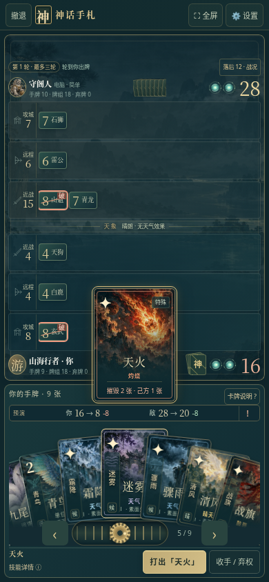

# 神话手札 v22 · 战术预演版

[直接下载 v22 完整资料包](https://github.com/ZZ677BIT/AI/raw/refs/heads/v22-tactical-preview/v22.zip)

全部解压，打开「神话手札-v22」里的 `01_双击试玩.html`。浏览器标题或设置应显示 **v22**，旧文件不会自动更新。

- 选牌时显示双方原分、新分及增减，场上单位标出增强、削弱、摧毁与保护。
- 天火明确提示己方误伤；间谍显示实际送敌点数和可抽张数；同袍计入已有单位加成。
- 战旗三个选项直接显示各排收益，手机无需悬停。
- 长按或点击预演栏 ⓘ / ! 查看本次具体计算与新手例子；提示不自动弹出大面板。
- 新增开发者沙盘「战术预演 · 同袍／天火／战旗」，无需完整打一局即可试验。

设置 → 开发者测试 → 实战沙盘，选择新的战术预演场景并进入即可。预演仅说明当前这一步，不推测敌方手牌或后续行动；查看、选牌及悬停不提交动作。

本轮通过 142 项规则与浏览器检查；其中新增规则矩阵与 198 次真实出牌逐一对比分数。包含原有手牌、飞牌、入库、教程、特殊牌、人机流程与模拟传输联机回归。包内附完整源码、图集、许可证、验证说明与截图预览；源码重新构建结果与试玩 HTML 逐字节一致。

检查在本环境 Chromium 运行，未实测实体手机 GPU 帧率、发热、功耗或两机 WebRTC 配对。单人素材内置，可离线运行。不同文件路径或浏览器的存档可能不共享，请保留旧文件和浏览器数据。
