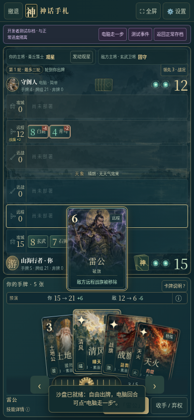

# 神话手札 v23 · 援阵破旗与对手个性版

[直接下载 v23 完整 ZIP](https://github.com/ZZ677BIT/AI/raw/refs/heads/v23-abilities-personalities/v23.zip)

全部解压，打开 `神话手札-v23/01_双击试玩.html`，浏览器标题应显示 v23。包内含离线游戏、源码、说明和手机视口截图。

- 土地公「援阵」增强同排其他单位，多个不叠加、离场失效；雷公「破旗」登场移除敌方远程战旗，之后可重新部署。分数预演、说明和演出同步支持。
- 五位电脑对手分别偏向均衡、手牌、近战、攻城与焚阵，难度独立选择。
- 设置新增 JSON 存档导出、校验预览及确认导入；导入前请求下载原进度备份，正常和测试存档隔离。不保存当前出牌对局。

快速测试：设置 → 开发者测试 → 实战沙盘 →「援阵与破旗 · 新能力试验场」。

好友对战双方必须使用 v23，旧邀请及回执需重新生成。旧版没有备份按钮，请保留旧游戏文件和浏览器数据；从 v23 起可显式导出备份迁移。

167 项规则和浏览器检查通过，含 45 场新对手倾向对局及 198 次真实出牌预演比对。浏览器测试在 Chromium 和模拟手机视口完成；实体手机的帧率、温度、功耗及两机 WebRTC 尚需实测。包内源码重建与试玩文件逐字节一致。

