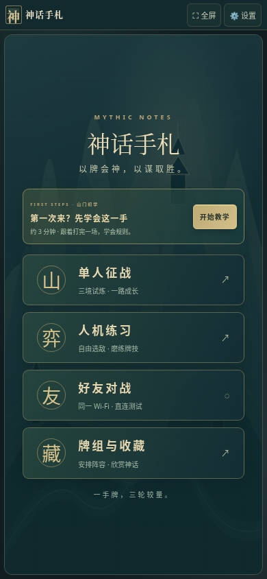
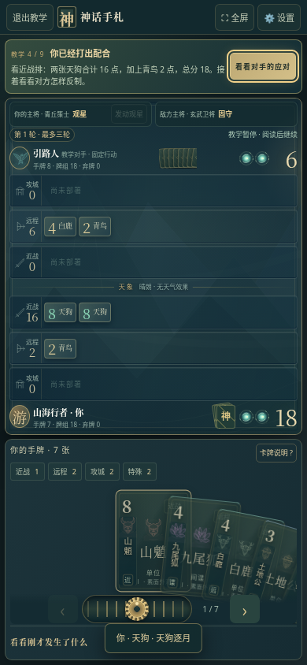

# 神话手札 v18 · 山门新手教学

[下载 v18（游戏、教学预览、说明与完整源码）](https://github.com/ZZ677BIT/AI/raw/refs/heads/v18-beginner-tutorial/v18.zip)

全部解压，用浏览器打开 `01_双击试玩.html`，首页点「开始教学」。可随时退出，设置里也能重玩。

教学使用一场固定对局，让玩家亲手练习：逐张发牌、拖牌自动落位、三排计分、天狗同袍、清风反制天气、领先收手、轮间留牌、命石与两轮获胜。每步只显示当前任务，高亮要操作的牌和按钮；观察分数后由玩家点继续。

完成后可去人机练习准备页、重玩或回首页，不自动开新局。教学不掉收藏卡、不计征战成绩，已有奖励保留；从设置进入时可以退出回原来的对局。完成标记保存在当前浏览器，开发者模式单独记录。

15 项新教学检查及 100 项规则、地图、单人流程和好友界面回归通过，共 115 项。手机适配以模拟视口和触摸输入验证，未进行实体安卓自带浏览器的帧率、温度实测。

好友直连沿用 v17 测试版，真实两机 Wi-Fi 连通尚未验证。好友流程的双浏览器检查使用有序消息测试通道，不代表真实 WebRTC 已验证。完整实现、测试命令和依赖许可证见 ZIP 中的源码资料。

旧版本 ZIP 保留。不同网址、本地文件路径或浏览器之间不保证共享存档，本版没有云存档迁移功能。
