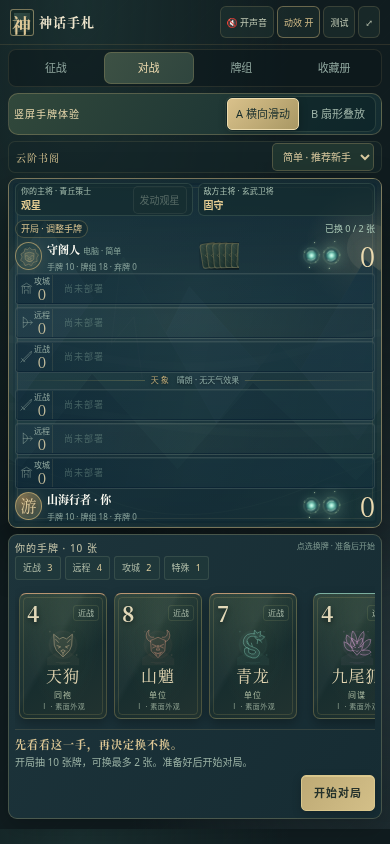
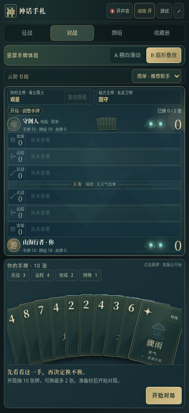

# 神话手札 v11 · 竖屏手牌双方案

[直接下载 v11 试玩包](https://github.com/ZZ677BIT/AI/raw/refs/heads/v11-hand-layout/v11.zip)

全部解压后，用 Chrome 或 Edge 打开 **01_双击试玩.html**。电脑默认显示手机宽度，进入后可随时切换 **A 横向滑动 / B 扇形叠放**，无需重开。两种布局都支持向上拖牌、自动落位和技能特效。

| A · 横向滑动 | B · 扇形叠放 |
| --- | --- |
| 完整看牌，左右滑动查找 | 卡牌叠放，点选抬起、放大查看 |
|  |  |

截图使用同一副手牌。试玩包包含游戏、离线对比页、完整源码和说明。

14 项竖屏触控检查、8 项表现检查、12 项征战检查通过；压缩包完整性和源码重建一致性通过。检查使用 Chromium 和模拟手机触控，尚未进行 iPhone / Android 真机性能测试。

当前为人机对战，双人联网房间尚未接入。音效可以开启和静音，动效可以关闭。

[v10 下载](https://github.com/ZZ677BIT/AI/raw/refs/heads/v10-download/v10.zip)
