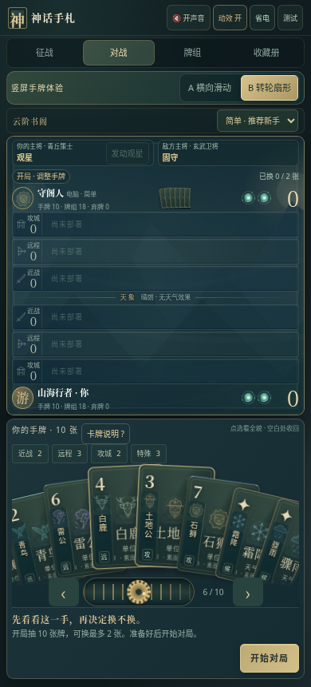
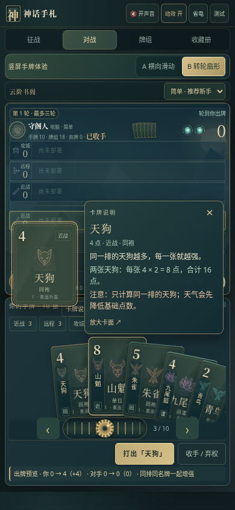

# 神话手札 v13 · 卡牌说明与节能动效

**[直接下载 v13 试玩包](https://github.com/ZZ677BIT/AI/raw/refs/heads/v13-guide-performance/v13.zip)**

全部解压，打开 **01_双击试玩.html**。手机建议保持顶部 **省电** 开启。

- 手牌区 **卡牌说明 ?** 开局就可查看全部 18 种牌。
- 点选后，完整卡面旁直接显示作用、组合例子和注意事项；再次点选、点空白或 × 收回。
- **B 转轮扇形** 加大牌间距，中心牌抬高放大，各张牌分别跟随、倾斜和回弹，停稳后停止动画帧。
- 修复转轮两端的离屏卡牌撑宽 Android 模拟视口的问题。
- 默认省电保留选牌、滑牌、发牌、出牌和技能动画，停止闲置循环光效。静音挂起音频；进入后台暂停动画、人机与声音，回来继续本场。

| 新版手牌与说明入口 | 点选后立即看懂卡牌 |
| --- | --- |
|  |  |

58 项浏览器检查通过：11 项说明与效率、13 项转轮、14 项竖屏、8 项表现、12 项征战。下载包完整性与源码重建一致性通过。

云端 Chromium 对照测量：普通闲置场景循环动画 **17 → 0**，20 张神辉手牌压力场景 **177 → 0**。性能记录随包附上。这里的测量不代表实体手机 CPU、GPU、温度或帧率，实际发热改善需在安卓自带浏览器中确认。

当前仍为本地人机试玩，双人联网房间尚未接入。

[v12 下载](https://github.com/ZZ677BIT/AI/raw/refs/heads/v12-rotary-hand/v12.zip) · [v11 下载](https://github.com/ZZ677BIT/AI/raw/refs/heads/v11-hand-layout/v11.zip)
