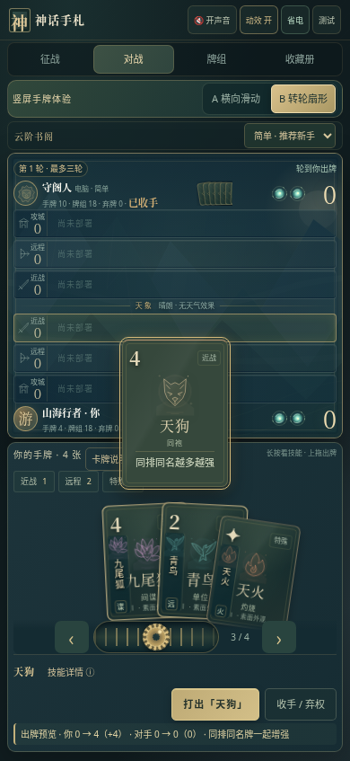
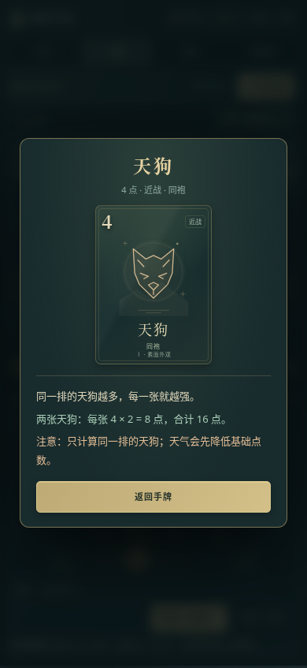

# 神话手札 v14 · 卡内技能与长按查看

**[直接下载 v14 试玩包](https://github.com/ZZ677BIT/AI/raw/refs/heads/v14-compact-skills/v14.zip)**

全部解压，打开 **01_双击试玩.html**。A 横向滑动 / B 转轮扇形都支持。

- **点选**：卡牌抬起，只在卡面里显示一句技能摘要，移除侧边大说明框。
- **长按约 0.42 秒**：查看完整技能、例子和注意事项。松手不会出牌。
- **左右滑动或上拖出牌**：自动取消长按，避免误弹详情。
- **再点或点空白**：收回卡牌；电脑端可点「技能详情 ⓘ」。
- 保留默认省电、后台暂停、静音挂起音频与逐牌跟随。

| 平时：紧凑卡内说明 | 主动长按：查看技能 |
| --- | --- |
|  |  |

55 项浏览器检查通过：9 项长按、14 项竖屏、13 项转轮、8 项表现、11 项说明与效率。压缩包校验、源码重建一致性通过。

手机验证使用 Chromium 模拟视口和触摸事件，未进行实体安卓手机帧率或温度测试。当前仍为本地人机试玩，双人联网房间尚未接入。

[v13 下载](https://github.com/ZZ677BIT/AI/raw/refs/heads/v13-guide-performance/v13.zip)
