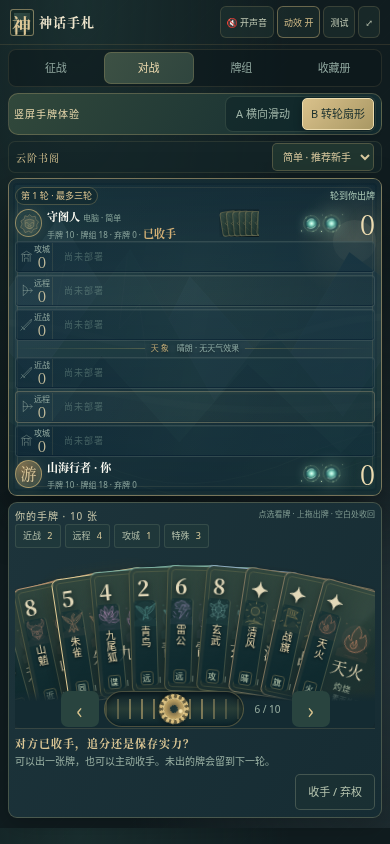
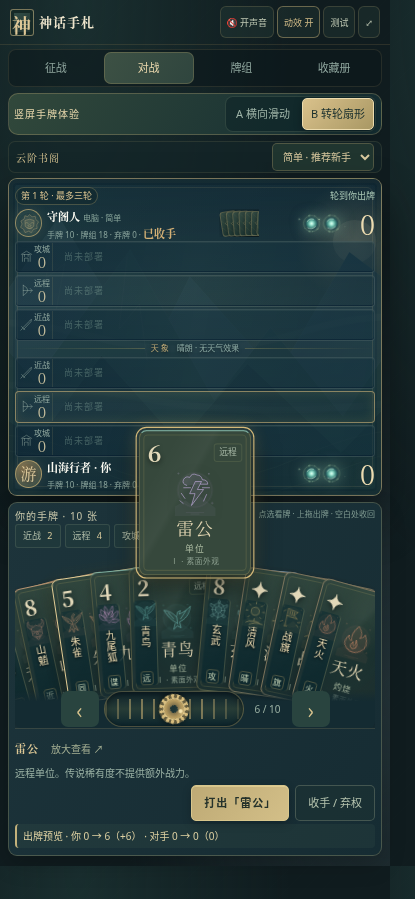

# 神话手札 v12 · 转轮手牌与流畅触控

**[直接下载 v12 试玩包](https://github.com/ZZ677BIT/AI/raw/refs/heads/v12-rotary-hand/v12.zip)**

全部解压，用 Chrome 或 Edge 打开 **01_双击试玩.html**，选择顶部 **B 转轮扇形**。A 横向滑动保留。

- 左右拖动手牌或下方黄铜齿轮，卡牌沿圆弧跟手转动，松手带惯性并自然停靠。
- 露出的牌边显示角色图标、竖排名字和技能标记。
- 点一次，完整卡面浮到手牌上方；再点一次或点空白处即可收回。
- 连续点选立即响应，发牌动画可打断，不必等结束后再点第二次。
- 上拖过线松手，继续自动落位；音效可开启或静音，动效可关闭。

| 转轮与露边识别 | 单次点选完整展开 |
| --- | --- |
|  |  |

截图为实际游戏画面。动态手感请在游戏中体验。

47 项浏览器检查通过：13 项转轮与连续触控、14 项竖屏操作、8 项表现、12 项征战。压缩包校验与源码重建一致性通过。

手机适配使用 Chromium 模拟手机视口与触控事件验证，尚未进行实体 iPhone / Android 帧率测试。当前仍是人机试玩，双人联网房间尚未接入。

[v11 下载](https://github.com/ZZ677BIT/AI/raw/refs/heads/v11-hand-layout/v11.zip) · [v10 下载](https://github.com/ZZ677BIT/AI/raw/refs/heads/v10-download/v10.zip)
