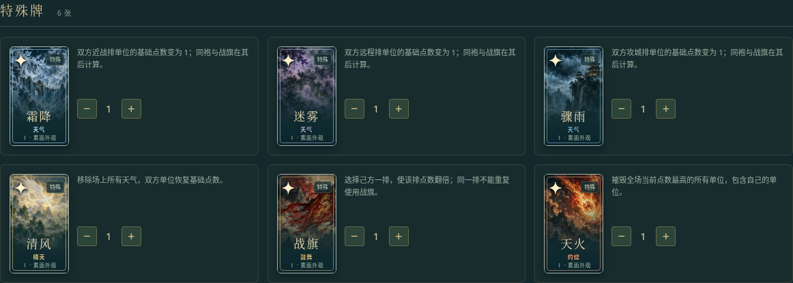
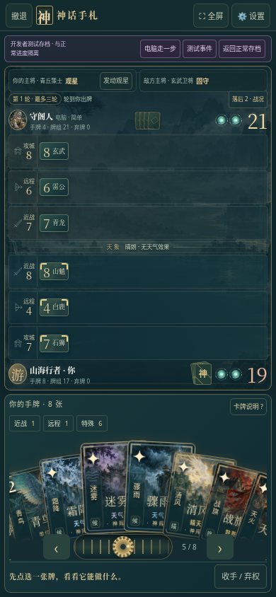

# 神话手札 v20 · 特殊牌与流畅度

[下载 v20 完整包（游戏、源码、预览、性能报告）](https://github.com/ZZ677BIT/AI/raw/refs/heads/v20-spells-performance/v20.zip)

全部解压，用浏览器打开 `01_双击试玩.html`。单人玩法无需安装引擎或额外服务器，脚本、样式与美术素材全部内嵌。

- 霜降、迷雾、骤雨、清风、战旗、天火全部使用水墨插画和独立技能演出，三档外观继续保留。
- 扇形手牌直接更新 transform，取消重复位移缓动；静止拖牌不持续重算落点。省电模式减少粒子、滤镜与碎片创建。
- 开发者测试台新增六种可操作沙盘、电脑单步、难度与秘宝阶数选择，正常存档与测试存档保持隔离。
- 设置及测试台增加 15 秒帧率采样和 JSON 导出；采样自动结束，切到后台即停止。

推荐：设置 → 开发者测试台 → 实战沙盘 → 六种特殊牌，进入后正常出牌，电脑回合点「电脑走一步」。测试流畅度可选「20 张手牌 · 滑动压力」，再启动性能采样。

163 项规则与浏览器检查通过，包含 270 场模拟对局。源码包重新构建与发行 HTML 逐字节一致。

同一云端 Chromium、390×844 触摸视口、省电模式、20 张神辉手牌持续滑动，两轮交替测试：v19 约 31–32 FPS，v20 约 59 FPS，P95 帧间隔从 66.7 ms 降至 16.7–16.8 ms。原始数据和可复现脚本在下载包中。

上述 RAF 回调测量不代表实体安卓的呈现帧率、温度或实际电池功耗，不保证所有设备稳定 60 FPS。建议在自己的手机上采样。好友直连沿用测试版：有序消息通道的双浏览器流程已检查，真实两机 Wi-Fi 与摄像头扫码仍未完成验证。

进度存于当前浏览器本地存储，换路径、网址、浏览器或设备不保证共享。请保留旧版与浏览器数据；没有云存档迁移。完整源码、说明与依赖许可证随包提供，旧版 ZIP 保留。
