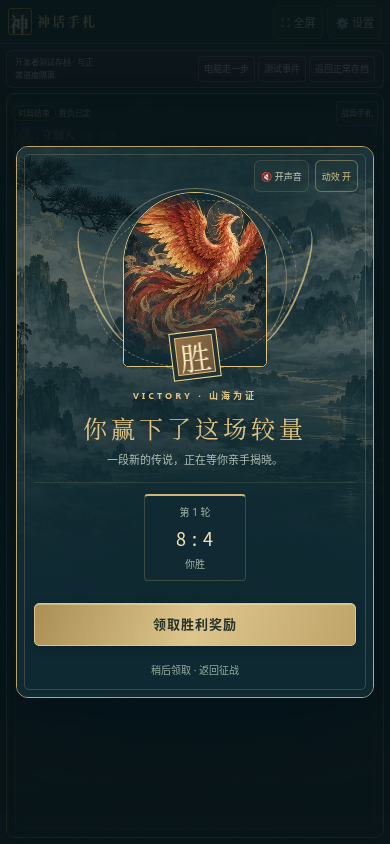
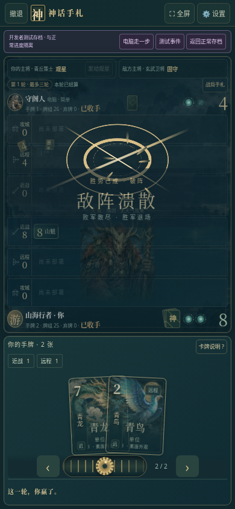

# 神话手札 v21 · 战斗演出与结算

[下载 v21 完整资料包](https://github.com/ZZ677BIT/AI/raw/refs/heads/v21-battle-cinematics/v21.zip)

下载后全部解压，用 Chrome 或 Edge 打开 `01_双击试玩.html`。游戏素材已内置，资料包包含源码和实现与验证说明。

- 出牌增加飞行拖尾、落点法阵与碎光，连接原有技能演出。
- 击溃增加胜方主将蓄势、定向冲击、败方碎裂与胜方退场；平局单独处理。
- 胜利、失败、平局采用不同神兽画面，展示真实轮次比分。
- 省电模式限制碎片数量，领奖待机动效会停止；动画结束或取消时清理临时节点。

在「设置 → 开发者测试」中选择事件，可直接预览出牌、胜负和奖励，不必打完一局。测试存档与正常进度隔离。奖励仍需手动翻牌和收进收藏册，不会自动开始下一场。

本轮通过 99 项规则与浏览器检查；包含 44 张场上卡牌的退场压力场景、动画取消和清理、320px 宽屏幕结算布局。打包源码重新构建后与试玩文件逐字节一致。联机检查使用模拟传输，未进行两部实体手机的连接测试；也未进行安卓真机帧率、温度或功耗测量，不承诺所有设备稳定 60 FPS。

存档保存在浏览器本地；更换浏览器或打开路径可能使用不同的存储空间，请保留旧版文件。
